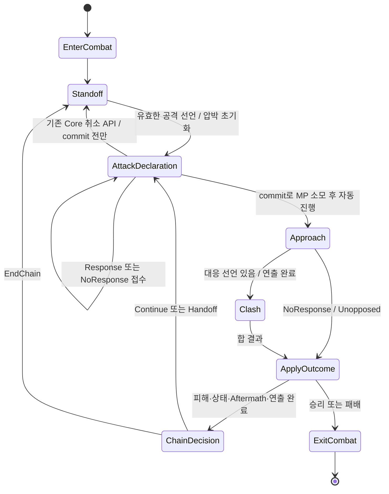

# CBT-ENEMY-03 — 트리키 몬스터 페이크 행동 및 타이밍 계약

조사일: 2026-10-17. **조사·설계 전용**. 이 문서의 신규 필드, 메서드명, 상태명과 처리 순서는 구현 제안이며 현재 API나 확정된 게임 규칙이 아니다. Production 코드·Asset·테스트를 수정하거나 Unity를 실행하지 않았다.

## 1. 기준선·보존·자료

- 적용 지침: 루트 `AGENTS.md`. 저장소 내 중첩 `AGENTS.md`/`AGENTS.override.md` 없음. Drive 읽기에 `google-drive/SKILL.md` 적용.
- Branch `main`; HEAD `1ebe3dd9be008ad063654aa72308f832192119b4` (`12`).
- `ProjectSettings/ProjectVersion.txt`: Unity `6000.3.23f1 (09d2ecc7fb28)`.
- 시작 시 기존 변경 25개: tracked 수정 9개, untracked 16개. ENEMY-02 Production 변경 7개, PARTY의 `PlayerFieldAttackController.cs`·`CombatPartyRosterPlayModeIntegrationTests.cs`, Profile/Conditional Policy/Snapshot 및 관련 테스트·meta·이전 보고서를 모두 기준선으로 취급했다. 기존 변경을 되돌리지 않았다.
- 이번 추가는 저장소 루트의 이 문서 하나다. 삭제·이동·공개 API·Inspector·SerializeField·기존 meta/GUID 변경 없음. commit/push 없음.
- 확인 자료: `CBT-ENEMY-01-Research.md`, 현재 ENEMY-02 코드, `FinalCombatEnemyBehaviorPolicyTests.cs`, `FinalCombatEnemyBehaviorPlayModeIntegrationTests.cs`, 기존 선언·FinalExchange driver·연출·명령 테스트 및 아래 결과 XML.
- 현재 코드가 ENEMY-01의 과거 조사보다 우선한다. 그 보고서의 “적별 authored policy 경로 없음”, “EnemyDefinition에 Profile 없음”, “HP 조건 선택 미지원”은 ENEMY-02에서 이미 해소됐다. 페이크·조기 행동·전용 타이밍 창은 여전히 미구현이다.

## 2. 기획에서 확인한 사실과 결정이 필요한 규칙

연결된 Google Drive의 [기능구현 문서](https://docs.google.com/document/d/1JF92rWAxIJ-RNvqJL5lw8CAa_OsVQu61ohmvH9YfVkA/edit)를 이번 조사에서 직접 읽었다. 같은 문서에 옛 AP/행동 슬롯 전투와 「새로운 전투 — 대치 / 합 / 연계 시스템」이 함께 있으므로 후자의 3~5, 7~15, 23절을 이번 설계의 관련 의도로 구분했다.

| 항목 | 실제 확인 내용 | 구현으로 확대 해석하지 않을 내용 |
| --- | --- | --- |
| 대치·압박 | 대치에서 MP 회복과 시간에 따른 압박 상승; 너무 오래 쉬면 적에게 공격권이 넘어감 | 적별 독립 게이지, 개별 상승률, 예외 비용·임계값 |
| 선언·대응 | 공격 선언으로 대치 종료; 합 승자 공격만 성공; MP 부족 시 대응 불가 | 시간제 Response 마감, 선언 변경·취소 권리 |
| 연계 | MP 범위 내 연속 행동, 자발적 종료, 적도 같은 기본 규칙 적용 | 페이크를 완료된 Exchange나 연계 횟수로 계산하는 규칙 |
| 23. 트리키 몬스터 | 일반 적은 기본 규칙 유지. 일부 2~3종과 특정 보스에 예외 사용. 예시는 압박 완충 전 페이크, 공격하는 척하다 다른 행동, 예상과 다른 타이밍 | 세 예시가 각각 별도 능력이라는 확정, 실제 조기 피해 공격의 허가, 몬스터별 수치 |

특히 “압박 완충 전 페이크”가 **실제 공격권을 빼앗아 피해를 주는 조기 공격**까지 뜻하지는 않는다. 아래 A/B/C는 구현 대안이며 셋 모두를 Production 요구로 확정하지 않는다.

다음은 원문에서 확정값을 확인하지 못했다.

1. 사용 몬스터 이름·종류·보스와 일반 트리키 적의 차이.
2. HP/Status/Pressure/경과 시간 등의 발동 조건과 확률, 조건 간 우선순위.
3. 전투당/대치당 최대 사용 횟수, 재사용 간격, 실패 시 사용 횟수 차감 여부.
4. 페이크 MP 비용, 취소 시 비용, 별도 조기 공격 비용·제한.
5. 선언 변경 허용 구간, 취소 후 공격권, 압박 유지/초기화, 재선언 가능 시점.
6. 시각·청각 단서, 가짜임을 언제 알 수 있는지, 관찰/간파의 역할.
7. 플레이어가 기다리기/선제 공격/대응 확정 등으로 대처할 수 있는지, 성공·실패 보상/페널티.
8. 타이밍의 시간 단위, 일시정지·슬로모션에서의 처리, 최소 대응 시간.

이 문서는 수치 예시를 Production 데이터로 만들지 않는다. 승인되지 않은 기능은 비활성 상태이며 기존 HP 선택 Profile만 있다는 이유로 페이크를 활성화하지 않는다.

## 3. 현재 Production 흐름과 추적 지점

경로는 모두 `Assets/GAME/Scripts` 아래다. 표의 `Core/`, `Model/`, `Integration/`, `Adapters/`, `Actions/` 축약 경로는 `Combat/Runtime/` 기준이다. 줄 번호는 조사 시점 기준이다.

| 경계 | 코드·근거 | 현재 동작 |
| --- | --- | --- |
| 전투 진입·Snapshot | `Combat/Runtime/Core/CombatEntryPoint.cs:349`, `Integration/EnemyCombatProvenanceBridge.cs:12`, `Adapters/FieldCombatantFactory.cs:103` | 정의의 선택적 Profile → 불변 값 Snapshot → 요청 → 적 combatant별 Session 등록 |
| HP 선택 | `Core/ConditionalFinalCombatEnemyDecisionPolicy.cs:14`, `Model/EnemyCombatBehaviorSnapshot.cs` | 명령을 선택할 때 현재 HP/MaxHP와 Snapshot의 조건 평가. 먼저 맞는 유효 스킬, 없으면 FirstValid. 시간 트리거 없음 |
| 적 명령 Owner | `Core/FinalCombatEnemyCommandController.cs:23` | Attack/Response/Chain 요청을 구독. 현재 request 참조가 맞을 때 동기적으로 제출. Profile 없는 적은 FirstValid 호환 |
| 매 프레임 | `Core/CombatEntryPoint.cs:72`, `Core/CombatFlowOrchestrator.cs:190` | `Time.deltaTime`으로 Orchestrator.Tick. Standoff에서만 StateMachine의 시간 진행 호출 후 자동 pump |
| 압박 | `Core/CombatStateMachine.cs:1573`, `Model/StandoffRuntimeState.cs:23` | 유효한 양수 delta에서 생존 참가자 MP 회복 후 `PressurePerSecond × delta`. 처음 Max에 도달할 때만 이벤트 발생 |
| 압박 공격권 | `Core/CombatFlowOrchestrator.cs:777`, `Core/CombatStateMachine.cs:1179` | Standoff에서 적 진영 공격권 부여 후 Attack 요청 발행. 선택한 첫 유효 적이 선언 |
| 선언 | `Core/CombatStateMachine.cs:109`, `Core/CombatDeclarationPolicy.cs` | version·phase·현재 진영·roster·생존·Stun/Panic·보유 스킬·target·MP 검사 후 선언 저장. 아직 MP 차감 아님 |
| 대응/commit | `Core/CombatFlowOrchestrator.cs:517`, `Core/CombatStateMachine.cs:313`, `Core/CombatExchangeCommitPolicy.cs` | Response/NoResponse 접수 후 pump가 즉시 commit. 공격자 비용, 가능하면 대응자 비용을 여기서 지불 |
| 실행 | `Core/CombatFlowOrchestrator.cs:598`, `Core/CombatStateMachine.cs:540`, `Actions/SkillRunner.cs:8` | 준비된 승자 스킬 실행 → 피해/Status → 체간/Stun/정신/Aftermath → 연출 요청 → 완료 후 최종 전이 |
| 종료 | `Core/CombatEntryPoint.cs:907`, `Core/CombatFlowOrchestrator.cs:900` | 적 컨트롤러 unbind, Director unbind, Orchestrator binding 교체·pending clear, CombatResult 생성 |

현재 전이는 다음과 같다.

초기 공격권은 `ExchangeState.InitialInitiative`에서 현재 공격 진영으로 전달된다. **적 선공이면 압박 0에서도 즉시 적 Attack 요청이 생긴다.** 연계 후 권한도 승자·인계·극복 등 기존 정책의 결과다. 따라서 “Max 이전에는 적이 절대 행동하지 않는다”는 현재 계약이 아니다. C안은 **현재 플레이어 권한인 Standoff를 예외로 선점**하는 기능으로 한정해야 한다.

## 4. 현재 지원 범위와 핵심 제약

### 압박과 명령의 중복

- `Session.StandoffState`는 하나다. UI도 이 공통 값을 표시한다. 적별 Profile은 이미 있지만 적별 압박은 없다.
- `Advance`는 Max 도달 순간 한 번 true를 반환하고 이후에는 false다. Max에 도달했는데 유효 적 명령이 없다는 이유로 새 압박 이벤트가 매 프레임 재발행되지는 않는다. 현재 컨트롤러는 공격 실패 시 극복 또는 권한 양도를 시도한다.
- 정상 선언은 압박을 0으로 초기화한다. `EndChain`은 선언·연계 상태를 정리해 Standoff로 돌아간다. Max 임계점 경쟁은 기존 phase/version과 request 검사로 낡은 제출을 거부한다.
- pump의 `_isTicking`, `_isPumping`, `_pumpRequested`는 재진입 제어다. “같은 프레임이면 플레이어 우선” 같은 게임 우선순위를 보장하는 계약은 아니다.

### 선언 취소와 비용

- `CombatAttackDeclaration`은 actor/target/skill을 생성자에서 고정하는 불변 객체다. 필드를 바꿔 선언을 교체할 수 없다.
- `TryCancelAttackDeclaration()` (`CombatStateMachine.cs:226`)은 commit 전 AttackDeclaration에서만 허용된다. 선언·대응·준비 결과·비용 기록을 지우고 압박을 초기화해 Standoff로 돌아간다.
- 이 API는 expected version 인자가 없고 Orchestrator의 공개 취소 창구도 아니다. 현재 요청 무효화/재발행·페이크 연출 취소·행동 ID 계약이 없다.
- `ClearDeclaration()`은 `ResetForStandoff()`와 다르다. ChainOwner/IsChainActive/HandoffCount까지 초기화하지 않으므로, **연계 중 페이크 취소에 그대로 사용하면 연계 잔여 상태가 남을 수 있다.** 기존 초기 선언 취소가 잘못됐다고 단정하는 내용은 아니며 향후 확장 위험이다.
- 선언 접수의 내부 이름 `CommitDeclaration`은 **MP commit을 의미하지 않는다**. 실제 비용과 `IsCommitted`는 `TryCommitExchange(version)` → `CombatExchangeCommitPolicy`에서 확정한다.
- Production의 version 검증 경로는 대응 MP 부족을 NoResponse로 낮추며 대응 비용을 지불하지 않는다. 공격 MP 부족은 commit 실패다. 인자 없는 호환 API의 일부 검사는 이 경로와 다르므로 페이크 기능을 그 API로 우회하지 않는다.
- 대응/NoResponse 접수는 동기 pump를 요청한다. UI가 잠시 입력을 숨기거나 다음 프레임에서 취소하려 해도 이미 commit됐을 수 있다. commit 이후 취소·환불은 V1 범위에서 금지한다.

### 타이밍과 표시

- `FinalCombatUIBinder.cs:381`은 phase, 대응/연계/공격 선택, 대표 HP/MP/체간과 공통 Pressure %를 보여준다. 현재 적의 예고 스킬·선언 revision·페이크 전용 신호·응답 마감시간을 표시하는 계약은 없다.
- UI의 Cancel 버튼은 `FinalCombatPlayerCommandController.CancelSelection`이며 선택 해제다. 공격 선언 취소 명령이 아니다.
- Director의 Approach 완료는 기존 callback을 통해 Core 진행을 재개한다. 이미 MP commit 이후다. 이를 늦춰도 플레이어 대응 창은 다시 열리지 않는다.
- FinalExchange에서는 피해·Status가 적용된 **뒤에** Outcome 연출 요청을 보낸다. `CombatDirector`의 `WaitAfterMove(skill)`/`ActionDelayAfterMove`를 늘리는 것은 피해 판정이나 Response 타이밍 변경이 아니다. Legacy 턴 연출의 같은 필드 사용과 구분해야 한다.
- Director의 ChainDecision 슬로모션은 표현 소유이며 Core 명령을 만들지 않는다. 실시간 타이밍 기능의 기준 시계로 사용하면 안 된다.
- 전역 상태는 EntryPoint가 FlowController를 통해 Standoff→CombatPlanning, AttackDeclaration/Approach/Clash/ApplyOutcome/ChainDecision→CombatResolving으로 연결한다. Response 입력은 CombatResolving 중에도 기존 전투 UI 명령 경로로 수행된다.
- `GameFlowController.Pause()`는 상태만 바꾸며 자체적으로 timeScale을 0으로 만들지 않는다. 확인한 EntryPoint.Update에도 Paused 검사 없이 deltaTime 진행이 있다. **새 타이머가 Pause에서 자동 정지한다고 가정할 수 없다.** 이번에 런타임 결함으로 재현하거나 수정하지 않았으며 향후 구현의 필수 확인 항목이다.

## 5. 세 대안 비교

분류 A/B/C는 대안 표의 이름이다. 사용자 요청의 ‘행동 유형 A=압박 선행, B=페이크 선언, C=변칙 타이밍’과 혼동하지 않도록 아래에서는 항상 전체 이름을 사용한다.

| 비교 | A안: 연출 전용 페이크 | B안: 선언 후 변경 | C안: 압박 선행 실제 행동 |
| --- | --- | --- | --- |
| 플레이 경험 | 움찔·시선·무기 예비 동작. 기존 선택 중 긴장감. 실제 대응 자원/공격권 변화 없음 | 예고를 읽고 기다리거나 대응 확정. 변경된 공격에는 새 대응 정보 필요 | 플레이어가 압박 게이지에만 의존할 수 없음. 실질적 행동권 선점 |
| Core/전역 상태 | 기존 phase/GameState 그대로. presentation intent만; pump 대기 없음 | AttackDeclaration 안의 명시적인 commit 전 substate와 선언 revision 추가 권장. 새 전역 GameState 불필요 | Standoff의 예외 권한·선언 원자 승인. 이후 기존 AttackDeclaration 경로. 새 전역 GameState 불필요 |
| 기존 코드로 되는 부분 | 애니메이션/VFX/표현 cue 전달의 패턴, 선택적 Profile 전달 | 불변 선언, 공통 유효성 검사, version, commit 단일 지불, 기존 Response/Unopposed | 압박 tick, 정상 선언 검증, 기존 Enemy Command·Response·전투 실행 |
| 새로 필요한 계약 | 읽기 전용 특수 판단 기회, 비차단 cue·actor별 소비 기록, 취소/cleanup | 명시적 허용 창·취소/교체 요청·경쟁 규칙·request invalidation | Standoff 특수 판단 호출 시점, 예외 자격 검증, 권한과 선언의 원자성 |
| 난도/충돌 위험 | 낮음~중간. 실제 피격/공격 cue 재사용·Animator 이동 간섭 주의 | 높음. Response와 경합, 이중 비용, 낡은 callback, Chain 잔여 상태 | 중간~높음. 선공·압박 Max·플레이어 입력·다수 적 경합 |
| UI/연출 | 확정 공격과 별개인 예비 동작. 정확한 단서는 기획 결정 | 예고/확정/철회/수정의 상태 표시. 낡은 버튼·target·선택 폐기 | 압박이 덜 찼어도 왜 적이 움직이는지 알 수 있는 단서. 실제 Response 유지 |
| 자동 검증 | cue 유무와 관계없이 command trace/MP/HP/권한/결과 동일 | 양쪽 경합 순서·commit 차단·취소 정리·교체 후 한 번만 지불 | Max 경계·실패 시 무변경·정확히 한 선언·선공 보존 |
| 최소 Owner 범위 | Profile/Snapshot/Session, 기존 Policy/Controller/Orchestrator, Director·cue 모델 | A의 데이터 전달 + ExchangeState/StateMachine/Orchestrator/Decision·UI 모델 | Profile/Snapshot/Session, Policy/Controller/StateMachine/Orchestrator; UI/Director 단서 |

권장 첫 단계는 **A안의 메모리 Fixture 기반 연출 전용 opt-in**이다. 「23」의 모호한 비용/Response 규칙을 확정하지 않고 표현을 검토할 수 있다. A안 완료를 B/C나 ‘트리키 몬스터 전투 규칙 완료’로 기록하지 않는다. B와 C는 별도 승인·구현 Batch다.

## 6. 공통 요청·상태·안전 계약 제안

아래 명칭은 설계용이다. 새 Enemy Manager, 새로운 EntryPoint, 독립 전투 실행기는 만들지 않는다.

1. **Profile 없는 적과 기능 off인 적:** 기존 Attack/Response/Chain 호출 순서 그대로. 기존 HP 우선순위 Profile에는 새 특수 기능이 기본 false/empty다. FirstValid 결과·난수 호출·MP·압박을 바꾸지 않는다.
2. **판단은 읽기 전용:** Conditional Policy는 후보 intent만 반환한다. HP/MP/Status/공격권·사용 횟수를 수정하거나 애니메이션 완료를 기다리지 않는다. Controller가 기존 Orchestrator에 제출한다.
3. **식별:** 지연 요청에는 현재 Session/binding epoch, CombatantId+roster 멤버, expected ExchangeVersion을 포함한다. 선언 변경에는 추가로 DeclarationId/revision이 필요하다. epoch는 이전 전투와 우연히 같은 ID/version을 구별한다.
4. **Version과 시간 분리:** Version은 상태 변이마다 증가한다. 대치 횟수·행동 횟수·cooldown으로 재사용하지 않는다. 세션 전용 StandoffCycleId/행동 ordinal 및 combat elapsed가 필요할 때만 따로 둔다.
5. **검증 후 한 번 적용:** 모든 필수 검사가 끝나기 전 공격권·비용·카운터를 수정하지 않는다. 승인된 요청만 사용 횟수를 기록한다. 동일 token의 재전송은 효과·차감·이벤트를 다시 발생시키지 않는다.
6. **Outcome 분리:** A안과 B안의 미확정 가짜 신호는 SkillRunner/Outcome/Chain 완료/Status duration/정신·체간 계산/CombatResult에 넣지 않는다. 0 피해 스킬도 Status와 연계 효과를 낼 수 있어 ‘가짜’ 대용으로 쓰지 않는다.
7. **기본 Response/Chain:** 변경 승인 전까지 기존 fallback 그대로. 특수 동작 V1은 Chain 시작·진행 중 금지 권장. 연계 취소 규칙을 함께 확대하지 않는다.
8. **취소 우선 조건:** 전투 종료·unbind·epoch 교체는 pending 전부 폐기. actor 사망/Stun/Panic/roster 이탈은 commit 전 pending을 폐기한다. target 사망/이탈은 무효화 후 기존 정책으로 새 후보를 선택하며 조용히 같은 선언의 target을 바꾸지 않는다.
9. **commit 이후:** 페이크 취소·스킬 교체는 거부한다. 실제 Skill 실행의 사망/Stun 유효성은 기존 Owner가 재검사한다. 지연 타이밍 V1은 commit 이후 새로운 무방비 대기 시간을 추가하지 않는 방향이다.
10. **UI와 Director:** immutable public view/cue를 받아 표시한다. raw state setter·MP 차감·SkillRunner·권한 변경 호출 금지. callback은 token을 가진 표현 완료 통지뿐이다. 취소/중복/낡은 callback은 무시한다.
11. **시계와 Pause:** 새 논리 deadline은 Orchestrator로 전달되는 전투 시간과 명시적인 진행 허용 여부를 사용한다. Pause에서는 deadline·신규 특수 승인 정지. unscaled wall clock이나 Animator 시간을 규칙 시계로 쓰지 않는다. 일시정지 중 완료된 표현은 자동 명령을 실행하지 않는다.
12. **실패 결과:** 최소 InvalidSession/StaleRequest/InvalidPhase/Disabled/ActorUnavailable/TargetUnavailable/InvalidSkill/InsufficientMp/AlreadyCommitted/AlreadyResolved를 구분해 테스트·진단한다. invalid Profile 수치나 미결정 필수 규칙은 기능 비활성 + 진단이며 무제한 재시도하지 않는다.

## 7. A안: 연출 전용 페이크의 정확한 요청 흐름 제안

압박 이전에 예비 동작을 보이려면 현재 Attack 요청 구독만으로는 부족하다. Controller가 아무 때나 Update를 돌리는 대신 **기존 Orchestrator.Tick의 Standoff 판단 기회**를 추가하는 최소 확장이 필요하다.

| 순서 | Owner | 요청/처리 | 취소·확정 조건 |
| --- | --- | --- | --- |
| A1 | Orchestrator | 정상 Standoff tick 처리 후 여전히 Standoff인지 확인, 선택적 관찰 판단 알림 | 정상 공격·압박 Max로 phase/권한이 바뀌면 만들지 않음 |
| A2 | Controller → Conditional Policy | 명시적으로 해당 기능 enabled인 적만 authored 조건 평가 | 조건/비용 등 미결정 데이터는 Production에서 활성화하지 않음 |
| A3 | Controller → Orchestrator | 설계명 `TrySubmitEnemyPresentationIntent(token, actor, cueKey)` | session/phase/actor/current-cycle/미소비 검사. 공격 선언이나 권한 요청 아님 |
| A4 | Orchestrator/Session | 승인된 소비 기록을 actor별 runtime에 저장하고 비차단 cue 발행 | phase·Pressure·MP·CurrentDeclaration·DecisionRequest·ExchangeVersion은 바꾸지 않음 |
| A5 | Director/UI | 예비 동작을 재생 | 완료를 기다려 pump/Pressure를 막지 않음. 실제 선언, 사망/Stun, phase 이탈·종료 시 표현만 중단 |

A안 cue의 승인 결과는 ‘보여줌/취소됨’뿐이다. 전투 피해가 발생했거나 Response를 강요했다고 기록하지 않는다. 실제 공격 cue와 같은 animation event가 피해 호출을 하지 않는지, transform root motion·이동 coroutine이 정상 Approach와 경쟁하지 않는지 확인해야 한다.

여러 적의 소비 기록은 독립적이지만 전투 규칙상 동시 공격을 만들지 않는다. 화면 혼잡을 막을 동시 cue 수는 별도 표현 결정이다. cue를 무시/스킵해도 원래 전투 결과가 동일해야 한다.

## 8. B안: 선언 후 취소·교체 계약 제안

### 권장 범위와 확정 시점

B안 최초 범위는 **Standoff에서 시작된 적 선언, 아직 Response/NoResponse가 한 건도 승인되지 않은 구간**만이다. 상대의 대응을 본 뒤 무조건 유리한 스킬로 바꾸는 AI는 제안하지 않는다. 그런 규칙은 별도 기획 승인 대상이다.

새 전역 phase 대신 AttackDeclaration 내 `TelegraphPending / Locked` 같은 명시적 substate를 권장한다. 선언 생성 시 결정된 변경 계획·논리 deadline은 Session에 저장한다. Director 재생 길이가 변경 시점을 결정하지 않는다. 일반 적은 새 대기 구간을 통과하지 않고 현재 경로 그대로 진행한다.

window와 변경 계획은 **최초 Response 이벤트 발행 전에 선언과 함께 설치**해야 한다. 기존 SubmitAttackDeclaration을 먼저 호출한 다음 window를 넣으면 동기 대응/commit이 이미 끝날 수 있다. 전용 opt-in도 같은 StateMachine 선언 검증과 기존 Orchestrator 안에서 처리하며, 중간 상태에서 재진입한 제출은 거부한다.

| 순서 | Owner | 제안 요청·처리 | 상태/비용 |
| --- | --- | --- | --- |
| B1 | Controller → Orchestrator → StateMachine | 특수 opt-in 선언을 token과 함께 접수. 기존 선언 정책 재사용 | AttackDeclaration/TelegraphPending; MP 미소모; Response 요청 공개 |
| B2 | UI Player Controller → Orchestrator | 현재 token에 대해 Response 또는 NoResponse 제출 | 유효한 응답이 먼저 승인되면 Locked로 바꿔 변경 권리 소멸. 기존 commit→Approach 진행 |
| B3 | Controller → Orchestrator | deadline이 먼저 도달하면 `TryReplaceEnemyDeclaration(oldToken, replacement)` | 모든 검사를 마친 후 새 불변 선언으로 원자 교체; version/revision 증가, 이전 UI 요청 무효화 |
| B4 | StateMachine/Orchestrator | 교체 성공 시 Response=Pending, 새 요청 발행 | 같은 attacker·target 유지 권장. 새 skill 보유/MP/target 재검증. MP 미소모. 재교체 루프 금지 |
| B5 | UI → Orchestrator | 새 Response/NoResponse 접수 | 교체된 실제 선언에 대해서만 commit 한 번. 기존 비용 정책으로 실제 스킬만 차감 |
| B6 | Controller → Orchestrator | 단순 철회 `TryCancelEnemyDeclaration(token)` | 아래 취소 목적지 규칙이 승인된 경우만 허용. Chain/준비 결과/pending 모두 정리 |

교체 실패(무효 스킬, 부족 MP 등)는 **기존 유효 선언을 유지**하고 feint 변경 권리를 종료하는 방향을 권장한다. 기존 선언도 무효라면 취소 정리 경로로 보내고 멈춘 Response request를 남기지 않는다. 가짜 선언 자체에 비용을 매기는 규칙은 미정이다. V1 교체 계약은 commit 전 자원을 지불하지 않는 기존 구조를 유지하며, 별도 페이크 비용 승인이 나면 기존 attack commit과 구별되는 단 한 번의 비용 계약을 먼저 설계해야 한다.

### 단순 취소의 목적지

기존 Core 취소를 그대로 노출하면 압박 0, 같은 적 권한, 남은 Chain 정보 등의 부수 효과가 생길 수 있다. **설계 제안**은 Standoff 복귀 시 `ResetForStandoff` 수준으로 완전히 정리하고, 취소한 쪽이 공격권을 상대에게 양도하며, 압박은 기존 새 대치 초기값을 사용하는 방식이다. 이는 공짜 연속 취소·즉시 재선언 루프를 막는 제안이지 기획 확정이 아니다.

취소 후 권한·압박·비용·사용 횟수 처리에 승인이 없으면 Production에서 B의 단순 취소를 켜지 않는다. 사망/Stun에 의한 시스템 무효화는 actor에게 권한을 남기지 않고, 생존 roster로 종료 판정 후 정상 Standoff 요청을 재발행하는 안전 정리가 필요하다. 대상 전멸이면 즉시 기존 종료 경로를 사용한다.

### Response와 경합

- 유효 Response/NoResponse와 교체가 같은 프레임에 들어와도 **현재 token에 대해 먼저 승인된 한 작업**만 상태를 변경한다. 동일 프레임 전체 우선순위나 Unity Update 실행 순서 독립성을 약속하지 않는다.
- 응답 우선: Locked+commit으로 전이; 뒤의 교체/취소 거부. 교체 우선: version/revision 변경; 이전 응답 거부; 새 응답 창을 보여준다.
- 창이 열린 동안 유효하지 않은 Response는 창을 닫거나 MP를 소비하지 않는다. 단순 스킬/target 선택은 확정이 아니다.
- 교체는 기존 Response를 재사용하지 않는다. 같은 상대라도 새 공격 정보를 본 뒤 응답하도록 한다. 최종 대응 가능 시간과 마감 시 NoResponse 자동 처리 여부는 기획 결정이며, 현재 시스템에는 시간제 Response 마감이 없다.
- 지연된 변경은 한 선언에서 한 번만 종결되어야 한다. 이것은 요청의 멱등성 규칙이며 몬스터의 전투당 최대 사용 횟수 수치를 정한 것이 아니다.

## 9. C안: 압박 선행 실제 행동 계약 제안

C안은 현재 플레이어 권한인 Standoff에서만 예외 선점을 평가한다. 초기 필드 선공 보존을 위해 **첫 정상 opening이 끝나기 전 선점 금지**를 권장한다. 이 적용 범위 역시 승인할 제안이며, 기존 InitialInitiative/StartReason 값을 고쳐 구현하지 않는다.

| 순서 | Owner | 요청/처리 | 불변식 |
| --- | --- | --- | --- |
| C1 | Orchestrator.Tick | 정상 MP/Pressure 진행을 먼저 수행 | 같은 tick에 Max가 되면 기존 정상 압박 경로만 수행 |
| C2 | Orchestrator → Controller → Policy | 여전히 Standoff, Allies 권한, Pressure<Max, 첫 opening 종료, 특수 enabled이면 후보 평가 | Profile 없는 적 제외. roster 순서/명시적 배열 우선순위로 결정적 1명 선택 권장 |
| C3 | Controller → Orchestrator | `TrySubmitEarlyEnemyAttack(token, actor, target, skill)` | 요청을 기존 진입점의 현재 session에 귀속 |
| C4 | StateMachine | Core에서 phase/token/기능자격/생존·Stun/Panic/대상·스킬·MP를 재검증 | 검증이 실패하면 권한·Pressure·MP·사용 카운터 모두 무변경 |
| C5 | StateMachine | 권한 부여와 실제 선언 저장을 하나의 동기 전이로 승인 | 성공 시에만 적 권한/실제 선언/version 갱신; 정상 선언과 같은 Pressure reset. InitialInitiative 불변 |
| C6 | Orchestrator | 이전 플레이어 Attack 요청 무효화 후 정상 Response 요청 발행 | 이후 commit·Approach·Clash/Unopposed·SkillRunner·Chain 전부 기존 경로 |

`TryGrantStandoffAttackAuthority` 호출 후 별도로 `SubmitAttackDeclaration`을 하는 두 단계는 중간 실패 시 권한만 탈취할 위험이 있다. 초기 유효성 확인과 최종 mutation을 같은 승인 경계에 둔다. 조기 행동의 추가 비용이나 cooldown은 임의로 만들지 않으며 필수 결정 전에는 실제 Production opt-in을 하지 않는다.

기존 `ExchangeState.CommitDeclaration`은 선언과 현재 actor/진영을 함께 저장한다. C는 예외 자격을 Core에서 확인한 뒤 이 설치 경계를 재사용하는 방향이다. 중간 권한 변경 이벤트를 먼저 공개하지 않고, 최종 phase/version이 정해진 뒤 최신 Response 요청을 발행한다.

플레이어가 먼저 선언했으면 C는 phase/version으로 거부된다. C가 먼저 승인되면 예전 플레이어 Attack 입력은 거부되고 기존 Response로 대응한다. 한 tick에서 여러 적이나 정상 압박과 조기 행동이 별도 실행되지 않도록 성공 후 특수 판단을 중단한다. 실패한 적 뒤의 다른 후보 선택은 승인되지 않은 mutation이 없어야 안전하다.

| 구현 방식 | 결과 | 판단 |
| --- | --- | --- |
| `StandoffState.Advance`로 Pressure를 Max까지 채움 | 공통 게이지와 UI를 거짓 변경. 정상 Max 이벤트/첫 유효 적 선택을 강제. 의도한 Profile actor와 다를 수 있고 다른 적에도 영향 | 사용하지 않음 |
| 진짜 조기 요청 | 실제 Pressure 값 유지하며 예외 승인 원인을 기록. 성공한 정상 선언 시점에만 기존 reset 적용 | C안에 필요한 계약 |

## 10. 변칙 타이밍의 두 범위

**연출 범위:** 예비 동작의 속도/길이, 준비 pose, 음향의 리듬을 바꿀 수 있다. 실제 명령·Response 요청·commit 시점에 영향을 주지 않는다면 A안이다. 기존 Director의 연출 대기 패턴은 재사용할 수 있지만 기존 Skill SO 수치를 이번 배치에서 변경하지 않는다.

**규칙 범위:** 선언 제출을 늦추거나 앞당기기, Response를 닫기, 미확정 선언 교체는 B/C의 명시적 논리 window가 필요하다. 특히 ‘Approach 애니메이션을 늦춤’은 이미 commit 뒤이므로 대응 시간을 늘리는 규칙이 아니다. ‘Outcome 애니메이션을 늦춤’은 이미 적용된 피해의 표시만 늦춘다.

논리 window를 둘 경우 timer만 기다리는 동안에도 death/Stun/terminal/epoch 검증은 진행해야 한다. 현재 Orchestrator는 StateMachine 시간 tick을 Standoff에서만 하므로 AttackDeclaration window deadline 처리는 별도의 기존 Orchestrator 시간 진행 지점 확장이 필요하다. Coroutine이나 animation event를 AI 명령 제출의 유일한 시계로 삼지 않는다.

## 11. Owner별 책임 및 데이터 분리

| Owner | 유지할 책임 | 특수 행동 확장 제안 |
| --- | --- | --- |
| Conditional Policy | 현재 상태로 유효 행동 후보 선택, FirstValid fallback | opt-in 조건 평가/후보 반환. 스케줄 실행·자원 mutation 금지 |
| Enemy Command Controller | 현재 request 확인 후 명령 제출·구독/해제 | Standoff/선언 window 판단 기회를 받아 특수 intent 제출. 독립 Update/Manager 금지 |
| CombatSession | 적 Snapshot·전투 전용 상태 | actor별 사용·cooldown과 현재 token/window 상태 보관. 전투마다 새 인스턴스 |
| CombatExchangeState | 현재 선언·응답·commit·결과·연계 | B 선언 ID/revision/window. 취소 시 reset 범위 명확화 |
| CombatStateMachine | phase·권한·유효성·비용 전이 | B 취소/교체와 C 원자 승인. Core가 최종 거부권 보유 |
| CombatFlowOrchestrator | 호출 시점·pump·pending request·표현 요청 | 특수 판단 기회, token 검증, invalidation, 논리 deadline·cleanup |
| SkillRunner | 확정 스킬의 실제 효과 | 변경 불필요. fake flags를 넣거나 가짜 스킬을 실행하지 않음 |
| CombatDirector | field 표현·VFX/SFX·camera·완료 통지 | A cue·철회/수정 cue 표시. combat state 직접 변경 금지 |
| FinalCombat UI/Player Controller | 최신 요청 표시·플레이어 명령 전달 | public telegraph view와 revision 변경 시 선택 폐기. UI에서 성패·비용 판정 금지 |
| EntryPoint/Flow/UI Router/Input | 기존 시작·종료·GameState·입력 소유 | 기존 mapping 유지. 새 global state/입력 경로 불필요. Pause 승인 경계는 후속 검증 |

### SO와 Snapshot

기존 `EnemyDefinitionSO.finalCombatBehaviorProfile` 연결을 유지한다. 현재 `attackPriorities(skillId, maximumHpRatio)`와 별개인 선택적 제작 블록을 **해당 Batch에서 필요한 것만** 추가한다.

- A: 명시적 enabled, 안정된 rule key, 승인된 발동 조건/표현 cue key. 제시되지 않은 확률·횟수·시간 기본값을 게임 규칙으로 넣지 않는다.
- B: fake 예고와 실제 후보 skill ID, 승인된 window/취소 결과 규칙. 최초 V1은 동일 actor·target, Chain 제외 권장.
- C: earlyAction enabled와 승인된 조건/추가 제한. 일반 HP 우선순위와 구분한다.
- Profile을 runtime에서 갱신하지 않는다. `EnemyCombatBehaviorSnapshot.FromProfile`에서 값 복사. 현재 구현은 attackPriorities가 비어 있으면 null을 반환하므로, 향후 ‘기존 우선순위는 비었지만 A만 enabled’ Profile을 유효 Snapshot으로 만드는 조건도 해당 Batch에서 검토해야 한다.
- 표현 asset 참조가 필요해도 Combat Core Snapshot에 scene GameObject/Animator를 넣지 않는다. presentation key를 Integration에서 해석한다.

### Runtime 위치

필요해질 때 Session 소유의 적별 runtime 레코드(설계명 `EnemySpecialBehaviorRuntimeState`)를 둔다. 키는 해당 세션의 combatant 참조/ID이며 static dictionary·SO 변경·Save 확장으로 저장하지 않는다.

- actor별: 사용 횟수, 다음 허용 combat time/cycle, 종결된 rule/token.
- 현재 행동: intent token, origin cycle, actor/target/skill ID, 선언 ID/revision, window stage/deadline, 단 한 번의 확정/취소 결과.
- 공유 경계: 실제 declaration/pump는 여전히 단일 Exchange다. 여러 적의 pending 공격을 동시에 commit하는 queue를 만들지 않는다.
- B window의 source of truth는 ExchangeState 한 곳이다. Session 레코드에 별도 CurrentDeclaration을 복제해 두 개의 진실을 만들지 않는다.
- binding 교체·승패·명시적 Abort·disable/unbind에서 pending과 coroutine 통지를 폐기한다. 다음 세션은 count/time/token을 새로 시작한다.

## 12. UI·입력·연출 계약과 직렬화 위험

플레이어에게는 **공개하기로 결정한 예고 정보**만 전달한다. 내부 `IsFake`, 다음 실제 스킬·확률·deadline을 UI에 그대로 노출할지는 기획 결정이다. A안 신호가 확정된 공격 Response 버튼을 켜면 안 된다. B안은 예고/응답 가능/확정/철회/수정의 최신 상태를 표시하고, revision이 바뀌면 이전 스킬·target 선택과 버튼 명령을 폐기한다. CancelSelection을 적 선언 취소에 연결하지 않는다.

반응 방법 V1 제안은 기존 스킬 Response/NoResponse를 유지하는 것이다. 전용 회피·방어·페이크 간파 버튼, 강제 QTE, 판별 확률·성공 보상은 이번 계약에 포함하지 않는다. 해당 요소가 필요하면 먼저 기획을 확정한다.

기존 CombatPlanning/Resolving 상태와 UI router를 계속 사용한다. Paused/Loading/Reward/종료 뒤에는 새 특수 요청을 승인하지 않는다. UI/Director는 전역 상태를 직접 쓰지 않는다. 실제 대응 UI가 Resolving에서도 동작한다는 사실을 보존하며 Exploration 입력을 다시 켜지 않는다.

참조 조사 결과 EntryPoint/Director는 `CombatRuntime.prefab` 및 여러 scene에 연결되어 있고, `FinalCombatUIBinder`는 `Prefabs/UI/ProductionDungeonUI.prefab`에 연결돼 있다. 이번에는 모두 미수정이다. 향후 추가 serialized field는 optional/default off로 두고 기존 필드명·타입·GUID를 보존한다. 새로운 UI가 필요하면 별도 연결 Batch에서 prefab Inspector 검증을 한다. 현재 Profile SO script GUID를 참조하는 GAME Scene/Prefab/Data asset은 검색에서 발견되지 않았다. 이것을 실제 몬스터 콘텐츠가 검증됐다는 의미로 해석하지 않는다.

## 13. Legacy/Demo/Debug 경계

- `DeterministicCycleEnemyCombatPolicy`는 Legacy plan 및 구형 `IEnemyCombatDecisionPolicy`와 관련된 호환 경로다. 소스 주석에 ‘current production baseline’이 남아 있지만 현재 FinalExchange의 실제 Owner는 Conditional→FirstValid이다.
- `CombatStateMachine.TrySubmitEnemyDecision(IEnemyCombatDecisionPolicy)`는 압박 Max를 요구하고 version 없는 선언을 호출한다. 조사한 Production 호출은 없고 기존 테스트 호출이 있다. 여기에 페이크를 구현하면 현재 Controller와 두 번째 판단 경로가 생긴다.
- `CombatAutoPlanner`는 Debugging이며 Phase.Planning 기반이다. FinalExchange 타이밍의 기준 Owner로 사용하지 않는다.
- `CombatDemoFlowController`는 canonical router/world lifecycle 우회 방지 분기가 있는 호환 연동이다. 조사한 GAME Scene/Prefab/Data에서 script GUID 직접 참조가 발견되지 않았다. `SeamlessBattleManager` 등 Legacy Battle Owner도 이번 대상이 아니다.
- `FieldEnemyPatrolAI2D`/`OverworldEnemyAI`의 순찰·추적은 필드 행동이다. 전투 페이크·압박 권한을 결정하게 만들지 않는다.
- 어느 호환 경로도 이번에 삭제·이동·리팩토링하지 않는다.

## 14. 향후 최소 수정 파일과 구현 Batch

각 행은 그 기능을 선택할 때의 예상 범위이며 이번 변경 목록이 아니다. `CombatEntryPoint`, SkillRunner, Reward/Quest/Save 정책은 특수 행동을 실행하는 새 Owner로 바꾸지 않는다.

| Batch | 필요한 최소 범위 | 완료 경계 |
| --- | --- | --- |
| ENEMY-04 권장: A 연출 전용 opt-in | `Combat/Data/FinalCombatEnemyBehaviorProfileSO.cs`, `Runtime/Model/EnemyCombatBehaviorSnapshot.cs`, `CombatSession.cs` 및 작은 전용 runtime/cue 모델, `Core/ConditionalFinalCombatEnemyDecisionPolicy.cs`, `FinalCombatEnemyCommandController.cs`, `CombatFlowOrchestrator.cs`, `Effects/CombatDirector.cs`·표현 cue 모델, Tests | Tests 메모리 Profile에서만 신호 검증. 실제 명령/비용/공격권/결과 trace 동일. Production 콘텐츠 수치·Scene 연결 제외 |
| ENEMY-04V | 전용 Editor EnterPlayMode 테스트 | 실제 Profile→Snapshot→기존 EntryPoint→신호와 정상 FinalExchange 종료. pause·중단·연출 누락 검증 |
| ENEMY-05: B 계약 구현 | 위 데이터/Owner + `CombatExchangeState.cs`, `CombatStateMachine.cs`, `CombatExchangeDecisionRequest.cs` 또는 작은 token 모델, `FinalCombatPlayerCommandController.cs`, `FinalCombatUIBinder.cs`, 필요 시 `PlayerCombatDecisionViewState.cs` | 허용 창·취소 목적지·비용 승인 후 단일 초기 적 선언의 교체/철회. Chain 페이크 제외 |
| ENEMY-05V | 선언 경쟁/교체·철회 실제 Play Mode 테스트 | Response 양쪽 순서, 한 번 지불, 사망/Stun, 종료 cleanup 증명 |
| ENEMY-06: C 조기 실제 행동 | 데이터/Session + 기존 Policy/Controller/StateMachine/Orchestrator, 승인된 단서 UI/Director | 기획이 실제 조기 공격을 승인한 경우만. 정상 압박·선공과 분리한 원자 승인 |
| 콘텐츠·배치 연결 | 별도 Production authoring 작업 | 몬스터/보스별 규칙·밸런스 확정 뒤 실제 SO/Scene/Prefab 연결·수동 검증 |

IFinalCombatEnemyDecisionPolicy의 기존 Attack/Response/CanContinue 호출자는 보존한다. 새로운 특수 판단 계약이 필요하면 기존 concrete policy의 좁은 추가 메서드나 선택적 확장으로 시작하고, 기존 구현체 모두에 불필요한 새 의무를 부과하지 않는다. A용으로 B/C 상태기계를 미리 전부 만드는 것은 권장하지 않는다.

## 15. 자동 검증 계획과 기존 실행 근거

### 향후 자동 검증 매트릭스 — 이번에는 미실행

| 상황 | 자동 검증할 불변식/결과 |
| --- | --- |
| 일반 적/Profile 없음/기능 off | 기존 FirstValid 선언·Response·Chain·MP·난수 trace 완전 동일. HP Profile만 있는 적에 페이크 없음 |
| Profile 적만 페이크 | 해당 적의 승인 cue만 발생, 비대상 적 runtime 무변경. A는 HP/MP/Pressure/version/결과 동일 |
| 가짜 선언 취소 | commit/SkillRunner/피해/Status/정신/체간/완료 Exchange 없음. 선언·Response·ChainOwner·Handoff·준비 결과·UI 요청 모두 정리 |
| 유효한 행동으로 교체 | 새 immutable declaration과 revision, 낡은 Response 거부, 새 Response 가능. 실제 스킬에 대해서만 MP 한 번 지불 |
| 부족 MP/무효 스킬·대상 | 제안 거부 무변경. 기존 유효 선언 유지 또는 명시적 시스템 취소. 절반의 권한 전이 없음 |
| Stun/Panic/사망 | commit 전 예약 폐기, 살아 있는 actor로 정상 후속 결정 가능. 전멸은 기존 승패 종료. 낡은 callback 무효 |
| Player Response 경쟁 | Response-first/replace-first/NoResponse-first 모두 명시적 결과. 중복 요청/버튼 연타/같은 frame 재진입에서 한 번만 확정 |
| Pressure 경계 | 0/직전/정확한 Max/넘는 delta에서 정상 Max 한 번. C와 같은 tick이면 정상 Max만. C 성공 뒤 정상 선언 reset |
| 선공 | 적 초기 선공은 Pressure 0 정상 시작. 플레이어 opening을 C가 빼앗지 않음. InitialInitiative/StartReason/OpeningEffect 불변 |
| 다수 적 | 서로 다른 Profile/무Profile 혼합, actor별 횟수·cooldown 독립, 같은 tick 후보는 한 실제 선언. 대상 사망 후 새 유효 대상 선택 |
| Session 전환 | 종료/Abort/disable/rebind 뒤 count/token/deadline/callback 누출 없음. 이전 epoch와 같은 숫자 version도 거부 |
| Clash/Unopposed/Chain | 기존 `CombatAttackDeclarationTests`, `CombatFinalExchangeDriverTests`, `CombatEnemyCommandIntegrationTests`, `CombatFinalExchangePresentationTests` 재실행. fake가 chain·handoff 횟수를 소모하지 않음 |
| Status/Posture/Panic/Overcome/All-Out | 기존 CombatStatus/CombatMental 회귀와 합쳐 fake에서 상태가 변하지 않고 확정 실제 공격에서만 기존 규칙 적용 |
| CombatResult/Reward/Quest/Party/Save | 실제 다인 승리·KO 포함 참가자 EXP·Completion 중복 차단 회귀. fake/철회에서 result·보상/quest progress 미발행. Schema 12 변경 없음 |
| Pause/표현 부재 | Pause 중 논리 timer/승인 정지, 재개 후 최신 요청만 허용. Director 없거나 비활성·완료 중복·늦은 callback도 무피해/무중복 |

Core/EditMode에서는 주입된 시간과 고정 난수로 경계·실행 순서 양쪽을 재현한다. 실제 EnterPlayMode에서는 ENEMY-02V 메모리 Scene fixture 패턴과 실제 EnemyDefinition→Bridge→EntryPoint 경로를 재사용하고 Profile을 Session에 직접 주입해 통합 경로를 생략하지 않는다. 실제 선택 스킬·MP·피해·상태·phase·CombatResult를 검사한다. Player Response는 가능한 한 실제 Player Command Controller를 경유한다.

수동 절차는 격리 Scene에서 ‘일반 적/기능 off/기능 on’ 대조 → 압박 상승 중 단서 관찰 → 예고 직전·직후 Response/NoResponse → pause/restart → Stun/죽음/다수 적 → 실제 승리·다음 전투 순서다. Production Scene에 임시 디버그 컴포넌트를 저장하지 않는다.

### 이번에 읽어 확인한 기존 결과 — 새 실행 아님

| 기록 | 유효 XML 결과 | 해석 |
| --- | --- | --- |
| ENEMY-02 전체, 2026-10-15 19:27 KST | `Logs/CBT-ENEMY-02-FullEditMode.xml`: 1,376 중 **1,375 통과 / 0 실패 / 1 ignored** | 이전 배치 전체 결과 |
| ENEMY-02V 전체, 2026-10-17 09:17 KST | `Logs/CBT-ENEMY-02V-AllEditMode.xml`: 1,377 중 **1,376 통과 / 0 실패 / 1 ignored** | 현재 확인한 마지막 유효 전체 EditMode. Combat 734, Integration 512 통과+1 ignored, 그 외 130 통과 |
| ENEMY-02V 집중, 09:18 KST | `Logs/CBT-ENEMY-02V-Focused.xml`: **9/9 통과** | 정책 EditMode 8 + 실제 EnterPlayMode 통합 1 |
| ENEMY-02V Combat, 09:20 KST | `Logs/CBT-ENEMY-02V-CombatRegression.xml`: **734/734 통과** | Combat 영역 회귀; 전체 프로젝트 결과와 구분 |
| ENEMY-02V 단독 Play Mode | `Logs/CBT-ENEMY-02V-PlayMode.xml`: **1/1 통과** | 집중 결과에 포함되는 동일 UnityTest이며 별도 독립 커버리지 1건을 더한 것이 아님 |

**이전 완료 보고 정정:** ENEMY-02V 당시 중간 확인에는 전체 XML이 없어 미완료로 보고했으나, 이번 파일 확인에서는 최종 XML과 `AllEditMode.log:164255` 저장 기록, `:164277`의 `Exiting with code 0 (Ok)`를 확인했다. 새로 재실행한 결과가 아니다. 이전의 ‘전체 XML 미확보’를 현재 유효 상태로 유지하지 않는다.

ignored는 `PartyRewardDiskSaveTests.EditorRestart_ReadPreviousProcessFiles_WithFreshRuntimeOwners` 한 건이다. 새 Unity 프로세스의 `-party05vRestartStage read`와 선행 write 조건이 필요하다. 이 조사의 새 ignored 실행도, 해당 read 검증 통과도 아니다.

ENEMY-02V Play Mode는 저 HP/고 HP인 **서로 다른 1v1 두 전투**에서 Profile Snapshot, 선택 스킬, 실제 MP·피해·Status, Unopposed, 승리와 Session 정리를 검증한다. 동일 전투에서 HP를 낮춰 다음 선택이 바뀌는 경우, 다수 적의 실제 타이밍 경쟁, 페이크 취소/선행 행동을 검증한 것은 아니다. 다수 Profile 독립성과 HP 경계/우선순위 등은 별도 정책 EditMode 근거다. 별도 PlayMode assembly/Player Build/실제 Dungeon 검증으로 확대하지 않는다.

기존 집중 테스트의 runtime Error/Exception 수집은 비어 있었고, 빈 Scene의 FieldLock/미연결 GameUIRoot 경고가 기록되어 있다. 이번에는 컴파일·테스트·Console 검사를 새로 실행하지 않았다. 미래 페이크 기능의 컴파일·Play Mode·통합 검증 상태는 **Unverified**다.

## 16. 권장 개발현황

- System: Combat / Tricky Enemy behavior and timing.
- Requirement: 기능구현 문서 「새로운 전투」 4·5·15·23절.
- Production Owner: 기존 Policy → Enemy Command Controller → Orchestrator → StateMachine/Session → SkillRunner, Director/UI는 표현.
- 이번 산출물: 요청·취소·확정·경쟁·cleanup 설계 완료. 특수 행동 구현은 **Not Implemented**, 검증은 **Unverified**.
- ENEMY-02의 조건부 HP AI와 ENEMY-02V의 기존 검증 결과는 별도 유지한다. 페이크 구현 완료로 승격하지 않는다.
- 권장 추적 상태: **Design Complete — Gameplay Decisions Required / ENEMY-04 A안 격리 구현 후보**.
- 남은 결정: 2절의 게임 규칙, B 취소 목적지·Response 창, C 실제 조기 공격 허가, Pause 시계·입력 확인, 실제 Production 콘텐츠/연출/Inspector 연결.

종료 확인: 기존 25개 변경 파일의 조사 시작·종료 SHA-256이 모두 동일했다. 추가 파일은 이 문서 하나이며 보호 Scene/Prefab/SO/meta와 Party/Reward/Save 정책은 수정하지 않았다. `git diff --check` 및 신규 문서 patch 공백 검사에 오류가 없었다. 기존 파일의 LF/CRLF 안내는 있었으나 실제 내용 변경으로 처리하지 않았다.
