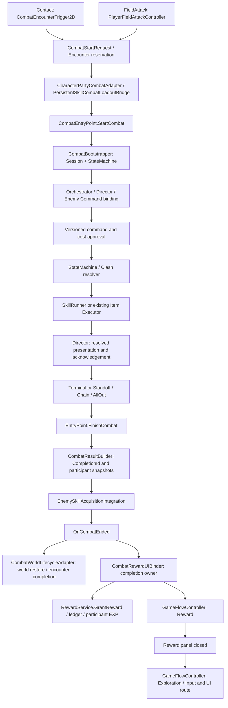

# CBT-R2-08 — 사전 통합 감사 및 Cutover 준비

감사일: 2026-10-29 KST. **사전 감사이며 Cutover를 시행하지 않았다.** 공식 콘텐츠와 Production 수동 검증이 남아 현재 전환은 차단한다. 05/06A의 Inspector·수동 Play Mode 보류를 유지한다.

## 범위와 근거

- 지침: 루트 `AGENTS.md`; 중첩 AGENTS/override 없음.
- Branch `main`, HEAD `6fa26d294472574097d33b884858ba0ee8bdc8b7`. commit/push/PR 없음.
- Unity ProjectVersion 및 실제 실행 Editor: 6000.3.23f1. Package/Input/URP 버전 변경 없음.
- 읽은 완료 보고: `CBT-R2-06A-Verification.md`, `CBT-R2-06B-Verification.md`, `CBT-R2-07-Verification.md`. 별도 `CBT-R2-05` 완료 보고서는 저장소에서 발견하지 못했다. `CBT-PARTY-05V-Verification.md`는 다른 Party 디스크 검증 Batch이므로 05 보고서로 대체하지 않았다. 05의 보류는 현재 작업문·후속 보고서·현재 코드로 확인한다.
- 근거 우선순위: 현재 코드/자산/실행 XML → 해당 보고서. 기존 보고서의 “코드 완료”를 정식 데이터나 Production 통과로 확대 해석하지 않는다.
- 보호 자산과 기존 변경을 포함한 1,246개 파일의 SHA-256을 `Logs/CBT-R2-08-BeforeHashes.json`에 기록했다. 대상은 Assets/GAME Scene/Prefab/SO/meta, ProjectSettings/Packages 및 기존 변경 파일이다.
- 이번 추가 파일은 이 보고서뿐이다. 실행 로그·감사·실패 증거는 Logs에 저장한다. 기존 코드/Asset/공개 API/SerializeField/GUID/Save schema 수정, 삭제·이동 없음.

## 1. 실제 Production 호출 흐름

이벤트 구독자 사이의 전체 순서를 위 다이어그램의 단일 직렬 실행으로 보장하는 것은 아니다. EntryPoint 내부에서는 ActiveSession을 비운 뒤 Film 처리를 시도하고 OnCombatEnded를 발행한다. World와 Reward는 같은 완료 이벤트의 별도 소유자다.

| 경계 | 실제 코드와 판단 |
|---|---|
| Contact / FieldAttack | `CombatEncounterTrigger2D.TryStartContact`와 `PlayerFieldAttackController.TryResolveHit`가 같은 `CombatEntryPoint.StartCombat`을 호출한다. Encounter 예약/Completion identity는 기존 World lifecycle 경계가 관리한다. |
| Party / Identity | `CharacterPartyCombatAdapter.TryBindSinglePlayerRequest`는 승인 시작 Definition이 없으면 기존 호환 leader 경로를 유지한다. 명시적 다인 BuildRequest는 선택된 Character ID/field binding/HP/level/loadout snapshot을 검증한다. 현재 실제 다인 필드 연결은 보류 상태다. |
| 장착 → snapshot | `PersistentSkillCombatLoadoutBridge.ApplyToRequest`가 장착 상태를 전투 시작에 복사한다. CharacterSkillRuntime은 영속 소유/장착 상태, Session은 전투 snapshot을 소유한다. |
| Session/StateMachine/Orchestrator | 단순 생성 순서가 아니라 Bootstrapper가 Session/StateMachine을 구성하고 EntryPoint가 Orchestrator/Director/EnemyCommand를 bind한다. StateMachine은 phase/승인, Orchestrator는 pump/요청/timeout/연출 acknowledgement를 담당한다. |
| 반복 합/비용 | versioned 선언/대응에서 유효성·MP/BP/손패를 검증하고 승인한다. ClashSeries의 라운드 계산과 완료 Exchange 효과 실행이 분리된다. 동기 콜백 재진입 보호는 기존 06B 가드 유지. |
| 손패/BP/Ultimate | Runtime 코드·테스트는 존재하지만 Production에서는 Hand/Clash/BP Debug opt-in이 설정을 주입한다. 이 fixture를 제거하는 것만으로 정식 기능을 유지한다고 판단할 수 없다. |
| 인계 | 기존 handoff 정책이 생존/기절/Panic/자원과 현재 owner/version을 검증한다. 실제 동료 field binding 및 UI/Input 통합은 Inspector·Play Mode 검증 필요. |
| Stun/AllOut | Terminal 우선 → 살아 있는 적 전원 기절 후보 → 기존 Chain 선택 요청 수락/거절/timeout → SkillRunner 실행 → 생존 시 Standoff 복귀. 기절은 Posture/Durability와 분리되며 Terminal에서 복귀하지 않는다. |
| Mental/Status | 완료 Exchange 정신력 변동·지속시간 감소, Panic/Overcome=35 유지. 사망/제거/Exit 후 추가 효과 차단. DoT/면역 등은 지원한다고 추정하지 않는다. |
| Item | UI Controller → Orchestrator 승인/잠금 → CombatItemUseExecutor → InventoryService 수량 변경/실패 복구. Adapter의 Changed/Refreshed 구독이 UI 갱신을 전달한다. 실제 Production Adapter/Catalog 없음. |
| 피해/연출 | StateMachine이 기존 SkillRunner로 효과 실행, Director는 해결된 결과를 표시하고 완료를 전달한다. 연출 이벤트는 새 피해 계산 소유자가 아니다. LegacyPlanning의 resolution 표현 경로는 별도 보존. |
| Terminal/Completion | EntryPoint의 종료 가드 → CombatResultBuilder snapshot → Film → 완료 이벤트. CompletionId 불일치 진단과 완료 1회 가드 존재. |
| Reward/EXP | 실제 주 경로는 `CombatRewardUIBinder.HandleCombatEnded` → `CreateCombatRewardRequest` → `RewardService.GrantReward`. Binder의 Processing/AwaitingClose/Completed와 Reward ledger가 중복을 방어한다. `GrantCombatResult`/RewardApplier는 호환 API이며 이 주 흐름과 구분한다. |
| GameState/Input/UI | EntryPoint는 기존 GameFlowController 경유로 phase를 동기화한다. Reward close도 FlowController → Exploration이다. GameInputInstaller/InputRouter, UIScreenRouter/GameUIRootController가 입력·root를 라우팅한다. CombatStateSyncer의 완료 관찰자는 호환용 no-op이며 두 번째 전환 소유자가 아니다. |

주요 코드 위치: `Assets/GAME/Scripts/Combat/Runtime/{Core,Integration,UI,Actions,Model}`, `Scripts/Player/Runtime/PlayerFieldAttackController.cs`, `Scripts/Reward/RewardService.cs`, `Scripts/Core/GameFlowController.cs`, `Scripts/Input`, `Scripts/UI`.

## 2. Production Owner 감사와 Cutover 위험

| 대상 | 현재 사용/경쟁 위험 | Cutover 시 조치 | 보존 조건 |
|---|---|---|---|
| CombatEntryPoint | Production 시작/종료 단일 소유자. Scene과 prefab의 별도 자산 존재가 곧 활성 중복 소유자는 아님 | 실제 Scene 1개 entry와 bind 대상 확인 | 새 start/end engine 금지 |
| CombatWorldLifecycleAdapter | encounter 완료·formation/camera/field 복귀의 기존 경계 | 한 entry에 한 lifecycle Owner 확인 | Reward 종료와 World 복귀를 임의 통합하지 않음 |
| CombatRewardUIBinder | 한 entry당 완료 UI 소유권 claim 존재 | 중복 binder/미연결 서비스/패널 검토 | RewardService ledger와 참가자별 EXP 유지 |
| CombatHandValidationOptIn | Dungeon `Runtime/Combat/CombatRuntime`에서 활성화, 고정 fixture 카드/skill 주입 | 정식 손패 설정 경로 승인·구현 후 별도 전환 | 이번 보류 상태에서 단순 제거 금지 |
| CombatClashSeriesValidationOptIn | 반복형 합 설정을 전투 시작 이벤트에 주입 | 정식 config opt-in/시작 계약 확정 | fixture를 Production Owner로 승격 금지 |
| CombatBpValidationOptIn | Dungeon/CombatRuntime prefab에 존재; Ultimate가 기존 Skill_skill2를 참조 | 정식 BP/Ultimate 데이터·runtime 설정으로 migration 필요 | 초기 BP 3 등의 fixture 값을 정식 밸런스로 채택 금지 |
| LegacyPlanning | 기존 별도 flow-mode 및 Planning HUD/resolution compatibility | 회귀로 계속 유지 | 이번 삭제/전환 금지 |
| CompatibilityCombatClashSideInputProvider | authored input 미설정 호환 경로 | 정식 authored 데이터 범위 및 fallback 사용처를 검토 | 무조건 삭제 금지 |
| CombatDemoFlowController / SeamlessBattleManager / BattleTrigger2D 등 | 코드/Legacy 존재는 활성 Production 경쟁의 증거가 아님. template gate는 Debug/Legacy 존재를 검출 | Scene별 GUID와 활성 여부를 읽기 전용 확인하고 별도 정리 Batch | serialized reference 감사 전 삭제/이동 금지 |
| DemoMission 통지 | CombatRewardUIBinder의 DemoMissionRuntime 존재 시 기존 compatibility 통지 남음 | Quest 완료와 중복 동작 여부 확인 | Quest/Reward 정책 변경·구형 Save 해석 변경 금지 |
| Start Definition / hero.test | Title의 TestHero와 빈 Start Definition이 기존 호환 동작 유지 | 공식 ID/성장 승인 후 migration 및 Continue 검증 | 기존 ID 강제 변경 금지 |
| 기본 prefab registry | CombatRuntime prefab은 빈 registry, Dungeon Scene은 4개 override | 어느 자산이 registry 작성 소유자인지 확정 후 개별 검증 | Scene override를 무단 Apply/Revert 금지 |

07 감사가 정적 참조만 보여주는 한계: 활성/비활성·초기화 순서·runtime fallback 성공·전체 GameObject Owner 경쟁은 실제 Play Mode에서 추가 확인해야 한다. UI의 빈 stateMachine 필드처럼 runtime resolve가 가능한 항목을 즉시 구현 결함으로 분류하지 않는다.

Runtime/Debug 분리 검색: `Scripts/Combat/Runtime`에서 Game.Combat.Debugging, 위 세 opt-in 타입 및 Game.Tests의 직접 참조는 발견하지 못했다. Session/StateMachine 생성 검색은 Production의 CombatBootstrapper/CombatEntryPoint 외에 `Scripts/Debugging/Combat/CombatTestRunner.cs`, `CombatStartSmokeTest.cs`를 찾았다. 이들은 Debug 경로로 유지하며 Production 진입점으로 간주하지 않는다. 코드 분리와 달리 실제 Scene/prefab의 Debug opt-in 직렬화 의존은 여전히 존재한다.

## 3. CBT-R2-05~07 구현·검증 매핑

| Batch | 코드/자산 근거 | 완료된 증거 | 남은 상태 |
|---|---|---|---|
| 05 | Party snapshot/binding, handoff, Enemy command/policy 및 관련 테스트 | 현재 코드 및 후속 회귀로 독립 지원 경로 확인. 독립 완료 보고서 미발견 | 실제 다인 Inspector/Production 검증 보류. 원래 완료 보고의 상세 증거는 확보 필요 |
| 06A | Stun recovery, AllOut Policy/Execution/StateMachine/Orchestrator/UI/Director | 보고서와 현재 EditMode/격리 EnterPlayMode tests | 실제 Dungeon 연결·Input/연출 검증 보류 |
| 06B | Mental/Status 완료 Exchange 경계, 실행 재진입/Exit·사망 보호, Item 복구/UI 이벤트 | 기존 1,554/8/1 + 현재 집중 회귀 | 무적/면역·DoT/HoT/출혈 계약 및 Production 통합 대기 |
| 07 | CombatProductionDataAudit, validation helpers/tests, 작성 가이드 | 기존 1,562/8/1 + 현재 읽기 전용 감사 | 정식 캐릭터/적/Film/Item/Status/Ultimate/AllOut Content Pending |

## 4. 연결 준비도

상태는 아래 주된 제한으로 분류한다. Ready는 현재 코드 경계의 독립 검증 범위이며 정식 Scene 전체 Ready를 뜻하지 않는다.

| 항목 | 상태 | 이유/해제 조건 |
|---|---|---|
| Title 초기 캐릭터 | Content Pending | 아난 공식 ID·성장 Definition 없음. Start SO 0, Title은 hero.test 참조 |
| PartyRuntime | Contract Pending | 편성 1~3 구현. 보유 6명 상한 미구현으로 정책/Save 검토 필요 |
| CharacterProgressionService | Code Ready / Asset Pending | 코드·Save 호환 회귀 존재, 공식 성장 데이터 없음 |
| CharacterSkillRuntime / snapshot | Code Ready / Asset Pending | 소유·장착·snapshot 지원, 공식 Film/Unique 0 |
| Skill Registry / Config | Validation Pending | Scene의 기존 스킬 1/2/11/12·Config 연결 확인. 정식 분류와 fixture 의존 제거 검증 필요 |
| Enemy Definition / AI | Content Pending | Definition/Profile 각각 0, Enemy_01~03에 source 없음 |
| Film / Unique | Content Pending | 승인 매핑·owner·category 없음 |
| Item Adapter / Catalog | Code Ready / Asset Pending | Adapter와 Inventory/Combat Catalog 전부 Production 미연결 |
| Status Definition | Contract Pending | 테스트 SO 4개만 존재. Buff/Debuff 기본 지원과 무적/면역/주기 효과 계약을 구분 |
| Combat HUD | Inspector Pending | 기존 root/button 연결은 정적 확인; statusListPresenter 미지정, Item root 계약 불일치. 실제 BP/손패/타이머·다인 배치 검증 필요 |
| Combat Input | Validation Pending | 기존 Input Installer/Router와 UI 명령 구조 유지. 실제 키/패드·Pause/재개·선택 focus 수동 미검증 |
| Completion / Reward / EXP | Ready (독립 코드 경계) | Completion/ledger/참가자 snapshot 회귀. 실제 콘텐츠 통합·중복 UI·World 복귀 검증은 별도 |
| Save / Continue | Validation Pending | 기존 schema 및 ID 유지. 이번 실행의 임시 디스크/동일 프로세스 검증과 Editor 재시작 검증 구분 |
| 실제 Production Cutover | Blocked | Content/Contract/Inspector/실제 Play Mode gate 미충족 및 기존 실패 8건 미해결 |

**Content Pending:** 공식 주인공 ID/성장/시작 정의, 정식 스킬 분류·비용/효과·손패, 일반/트리키 Enemy 데이터와 AI·Film drop, Film/Unique owner/unlock, Inventory/Combat Item 정의·Catalog, Status 제작 데이터, Ultimate/AllOut 효과/밸런스.

**Inspector Pending:** Title Systems와 Dungeon Runtime의 RuntimeBootstrapper.characterStartDefinition; Dungeon Runtime/Combat/CombatRuntime의 Item Adapter 및 Inventory/Catalog 참조; World/Encounters/Encounter_01~03/Enemy_01~03의 EnemySourceComponent.definition; FinalExchangePanel statusListPresenter와 실제 다인/손패/BP/타이머 UI; Director·Input·field binding 실동작. 정확한 기존 root/field/asset 목록은 재실행한 `Logs/CBT-R2-07-ContentAudit.md`와 07 보고서에 있다.

## 5. 기존 실패 8건 상세 분석

전체 이름/원문 message/stack은 `Logs/CBT-R2-08-FailureEvidence.md`에 보존한다. 아래의 fixture 문제 분류는 해당 실패가 전체 기능을 부정하는 범위를 제한할 뿐, Cutover 통과로 바꾸지 않는다.

| ID | 정확한 테스트 이름 | 원문 핵심 | Production 영향 / 분류 / 권장 Batch |
|---|---|---|---|
| F1 | Game.Tests.Combat.CombatItemUsePlayModeIntegrationTests.IsolatedFinalExchange_ItemAdapterInventoryAndBinderRunInActualPlayMode | Expected: not null; But was: null. RunScenario item lookup | SkillListRoot 기대와 HandoffListRoot 실제 표시 불일치. 별도 current-root fixture는 통과. UI 위치 계약/기대값 충돌이며 소비 결함을 증명하지 않음. 정식 Item UI 계약 확정 및 fixture 정렬 Batch. 기대값 임의 수정 금지 |
| F2 | Game.Tests.Integration.DungeonOneProductionSceneTests.ProductionDungeonOne_HasCanonicalCombatRewardUiCameraAndBootstrapOwners | Forbidden Demo/Debug/Test/Legacy component remained: Game.Combat.Debugging.CombatHandValidationOptIn on CombatRuntime. | 실제 Scene의 fixture 의존과 clean Production gate 충돌. canonical owner 검사는 이 선행 실패 뒤 평가되지 않으므로 그 부분 통과도 실패도 단정 불가. 승인된 손패/BP/Clash Production migration Batch |
| F3 | Game.Tests.Integration.DungeonOneProductionSceneTests.ProductionDungeonOne_HasExplicitInteractionOwnersWithoutLegacyInteractionPaths | F2와 같은 ValidateProductionScene 예외 | 같은 선행 gate. Interaction 자체 결함이 증명된 것은 아님. F2 migration 뒤 재실행 |
| F4 | Game.Tests.Integration.DungeonOneProductionSceneTests.ProductionDungeonOne_HasOneCanonicalRepeatableNpcInteraction | F2와 같은 예외 | 같은 선행 gate. NPC 정책 변경 근거 아님. F2 migration 뒤 재실행 |
| F5 | Game.Tests.Integration.DungeonOneProductionSceneTests.ProductionDungeonOne_HasQuestDerivedCompletionContractWithoutLegacyExitOrFallbackDestination | F2와 같은 예외 | 같은 선행 gate. Quest/Completion 정책 변경 근거 아님. F2 migration 뒤 재실행 |
| F6 | Game.Tests.Integration.DungeonOneProductionSceneTests.ProductionDungeonOne_IsCleanEnvironmentMigration | F2와 같은 예외 | 실제 정식 Scene이 Debug-free gate를 만족하지 않음. 단순 테스트 환경 잡음으로 무시할 수 없음. F2와 함께 별도 cutover migration |
| F7 | Game.Tests.Integration.FilmUniqueProductionPlayModeTests.ProductionScene_ContactAcquire_UIEquip_FieldInputSkill_ColdSaveLoad | [CombatHandValidationOptIn] Ally 0 has no matching session skills. Check the selected fixture. | transient Film registry와 고정 Hand fixture의 충돌. FieldAttack → StartCombat → Clash validation → Hand error. Film 저장/장착 전체의 결함으로 확정할 수 없고 해당 test는 이후 단계 통과 증거도 아님. 정식 hand startup 경계와 Film fixture 격리 Batch |
| F8 | Game.Tests.Integration.ProductionSceneWiringTests.DungeonTemplate_IsCanonicalSingleOwnerProductionSource | Expected: False; But was: True (forbidden component predicate) | Dungeon_Template의 CombatRuntime prefab 인스턴스가 Debug CombatBpValidationOptIn을 포함. template/prefab 정리·소유권 migration Batch; 실제 사용 Scene과 template를 구분 |

최초 확인된 **조사 범위 내** 기준선은 `Logs/CBT-R2-06A-AllEditMode-1.xml`이다. 이 실행은 현 8건 외 당시 Status fixture 실패도 포함하며, 06A Final에서 현 8건으로 정리됐다. 06B·07에서도 동일 8건이 유지된다. 개발 전체에서 최초 발생한 커밋/시점은 dirty 변경 이력과 이 로그만으로 확정하지 않는다. `Logs/Combat05Regression.xml`에는 현 실패 증거가 없지만 그 사실만으로 05 전체가 해당 Scene gate를 통과했다고 소급하지 않는다.

현 8건은 이번 선택 실행에서 전부 재현됐다. F8은 `Dungeon_Template.unity`의 m_SourcePrefab GUID `1bfc52cd235e809449d17d48571f5a38` → `Prefabs/CombatRuntime.prefab` → CombatBpValidationOptIn script GUID `4bd31fad07c44e9795d18530d37a6855` 경로를 정적으로 확인했다. 보호 자산을 덮어쓰는 테스트는 실행하지 않았다. 원본은 읽고, Play Mode 테스트의 콘텐츠는 transient 복제본/인스턴스이며 저장하지 않는다.

## 6. 필수 수동 순서와 통과 기준

현재 미실행이며, 다음을 별도 승인된 통합 검증 순서로 사용한다.

1. 콘텐츠/계약 확정: 아난 공식 ID·성장, 적 일반/트리키·Film, Item/Status, Ultimate/AllOut·손패/BP 계약 승인. 임의 기본값으로 Pending을 채우지 않는다.
2. 연결 사전검사: 07 감사 재실행 → required 참조/중복 ID/key/owner/GUID 확인. 각 UNASSIGNED는 optional/runtime resolve인지 근거로 판정. Inspector 연결을 저장할 때 지정 자산만 diff에 남아야 한다.
3. New Game / Continue: 초기 보유·편성·리더 1명 일치, 기존 hero.test 저장 정보 보존. 공식 시작 Definition은 Title/직접 Dungeon 동일. 복원/반복 Load가 이미 복원된 파티를 재초기화하지 않아야 한다.
4. Contact / FieldAttack: 같은 entry·encounter reservation·party identity/snapshot. 실제 1/2/3인에 누락·중복 field binding이 거부되고 HP/MP/스킬이 올바른 참가자와 대응해야 한다. 05 보류 해제 후 실행한다.
5. 반복 합/자원/AI/인계: 3라운드 중 정신력/지속시간 중복 정산 없음, 승인만 비용 소비, stale/중복 거부, Panic/기절/사망 제한, 손패·BP·적 일반/트리키 정책 및 동료 인계 확인.
6. Stun/AllOut/Ultimate: Terminal 우선, 전원 기절 후보, 수락/거절/timeout, 중복 연출 무피해, 생존 시 복귀, 종료 후 지연 효과 무적용. 06A 보류 해제 후 실제 카메라/Animator/timeScale/fixedDeltaTime까지 확인.
7. Item/Status: 실제 제작 데이터로 1회 소비/효과, 재고 변경 UI 갱신, 실패 복구·사망/취소·Scene 이동 구독 해제. 미지원 효과는 명세/구현 완료 전 테스트 통과로 기록하지 않음.
8. 승리/패배/Abort/Reward: Completion 1회, 참가자/KO/비참가 EXP 구분, 중복 result 무변경, Reward close → Exploration, 이동/상호작용 입력 복귀. Pause/대화/Loading 중 Exploration 입력 차단.
9. Film 장착 → 다음 전투 snapshot, 실제 디스크 Save → Editor 완전 종료 → 새 프로세스 Continue. 해당 재시작 검증과 Player Build는 독립 실행/증거를 남긴다.

## 7. A~E 판단 및 CBT-R2-08 진입 조건

- **A 지금 완료:** 사전 구조/실패/자산 감사, 기존 기술 경계 및 격리 자동 검증, Cutover checklist. 07 Validator/작성 가이드. 정식 데이터/실제 Scene 완료는 포함하지 않음.
- **B 콘텐츠 승인 후 가능:** 시작/성장/스킬/적 AI/Film/Item/Status/Ultimate/AllOut SO 작성 및 연결. 별도 생성/연결 Batch에서 최소 diff와 GUID를 검증.
- **C Inspector 연결 후 가능:** 실제 1~3인 field binding, Item Adapter/Catalog, HUD/Status/Director/Input 참조를 정식 콘텐츠로 검사. Inspector만 연결했다고 Play Mode 통과로 처리하지 않음.
- **D 실제 Play Mode 필수:** 물리 Contact/FieldAttack, 실제 입력·focus, UI/카메라/Animator/시간 복원, Pause/Abort/Scene 전환, 1~3인 인계, 실제 Reward/Continue. 정식 콘텐츠로 순서 3~9 수행.
- **E Cutover 차단:** 공식 콘텐츠 없음, 손패/Clash/BP Debug opt-in에 Production 의존, 05/06A 보류, Item root 계약 불일치·template gate, 실제 Scene 수동 통합/Player Build 미검증, 미지원 Status 계약, 보유 6명 Party 정책 불일치. 미지원 효과는 정식 MVP에서 제외할지 구현할지 범위 결정이 필요.

전체 통합 검증을 시작하려면 승인된 콘텐츠 최소 범위와 Debug 대체 방식, Inspector 변경 범위, 보류 해제 범위를 먼저 확정해야 한다. 현 상태에서도 격리 코드 검증/읽기 전용 감사는 진행 가능하다. Cutover 승인 gate는 기존 실패의 원인별 해결·수용 기준 확정과 실제 콘텐츠/입력/복귀 검증 증거를 요구한다. 이번 감사는 그 승인을 대신하지 않는다.

## 8. 최종 자동 검증 / Git 보존

이번에는 보호 자산 저장 호출이 없는 기존 집중 fixture 및 현 실패 8개 테스트를 명시적으로 선택했다. 필터는 `Logs/CBT-R2-08-TestFilter.txt`.

- 실제 Unity 6000.3.23f1 실행: **407 PASS / 8 FAIL / 1 IGNORED**, 총 416. `Logs/CBT-R2-08-SafeRegression.xml`, `.log`; Unity 종료 2는 기존 실패를 반영한다. C# 컴파일 오류 및 컴파일 경고 없음(이번 실행 로그 기준). 런타임 진단/예외는 failure evidence 및 원본 로그와 구분해 보존.
- 07 전체 기준선 **1,562 PASS / 8 FAIL / 1 IGNORED**와 실패 이름을 직접 비교해 차이 없음. 이번에 전체 1,571개를 실행한 것으로 보고하지 않는다. 신규 실패 없음은 선택 실행 범위 안에서의 판단이다.
- 07 Production 감사 8개 검사 통과. 최신 보고서는 `Logs/CBT-R2-08-ContentAudit.md`로 복사 보존. Assets 수/연결의 Pending 상태는 07과 동일.
- Stun/AllOut, 반복 합, BP/손패/Ultimate, 인계·Party snapshot/Character 시작, 적 정책, Mental/Overcome/Status/Item UI, Completion/참가자 EXP/Reward, SaveLoadPreparation 및 PartyRewardDiskSave의 임시 디스크·동일 프로세스 복원 회귀 포함. 해당 fixture 실행은 보류된 정식 Production 수동 검증을 대신하지 않음.
- Ignored는 기존 `Game.Tests.Integration.PartyRewardDiskSaveTests.EditorRestart_ReadPreviousProcessFiles_WithFreshRuntimeOwners` 1건. 이번에 별도 write/read Editor 재시작 단계는 실행하지 않았다.
- 미실행: 전체 회귀 재실행, 정식 콘텐츠 Production 수동 Play Mode/Inspector, Player Build, 실제 디스크 Editor 재시작 검증. 범위 제한과 콘텐츠/연결/보류 조건 때문이며 pass로 기록하지 않는다.
- 1,246개 snapshot 파일은 실행 후 모두 SHA-256 동일. 보호 Scene/Prefab/SO/meta 및 Packages/ProjectSettings와 기존 미커밋 변경 보존. 신규 코드는 없고 이 보고서만 추가했다. Logs의 해시/필터/실행/감사/실패 증거만 생성.
- 신규 보고서 공백 검사 통과. 전체 `git diff --check`는 기존 폰트 공백 3곳 및 Dungeon_1_Production Scene 공백 1곳을 보고하며, 이들은 시작 당시 파일 해시와 동일한 기존 변경이다. 이번 감사에서 수정하지 않았다.

## Development tracking

- System: Combat / Character / World / Reward / Save / Input / UI.
- Feature: CBT-R2-08 사전 통합 감사 및 Cutover 선행 조건.
- Production Owner: CombatEntryPoint와 기존 Session/StateMachine/Orchestrator/Executor, World lifecycle, Reward/UI/Flow 소유권 유지.
- Requirement: 이번 CBT-R2-08 사전 감사 작업문.
- Implementation: 사전 감사 완료. 전체 CBT-R2-08/Production Cutover는 **In Progress / Blocked by Content and Validation**.
- Compile/자동 검사: 최종 기록 참조. 기존 전체 기준선과 이번 선택 실행을 구분.
- Inspector: 읽기 전용 serialized 참조 확인, 실제 조작 미실행.
- Play Mode: 격리/임시 콘텐츠 테스트와 정식 Production 수동 검증을 구분; 후자 미실행.
- Integration: 실제 콘텐츠/전체 Scene Cutover 미검증, 05/06A 보류 유지.
- Recommended tracking: **Pre-audit Complete — Cutover Blocked / Content·Contract·Inspector·Production Validation Pending**.
- 기존 문서 주의: PARTY-05V는 R2-05 완료 보고가 아님. skill.production key와 Compatibility 분류, Debug fixture 연결은 정식 콘텐츠 승인 증거가 아님.
